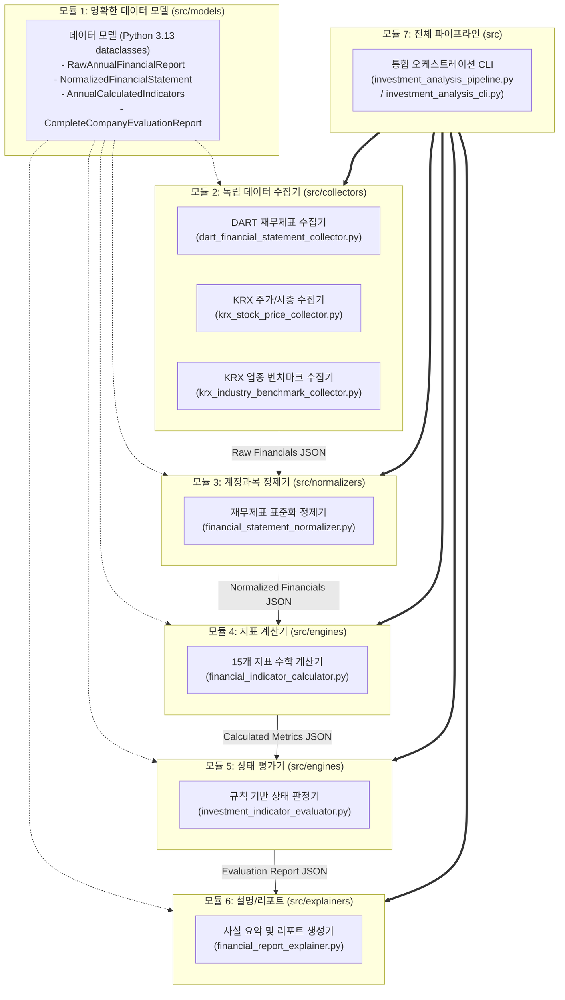

# 주식 투자 분석 시스템 모듈별 독립 구현 계획서
> **Modular Implementation Plan & Step-by-Step Roadmap**
> 원칙: "모든 기능은 단일로도 독립 동작해야 하며, 이를 파이프라인으로 이어붙여 하나의 프로세스를 완성한다."

---

## 1. 모듈별 독립 구조 (Decoupled Architecture)

각 모듈은 외부 의존성을 최소화하고, 독립적인 CLI 실행 명령과 입력/출력 JSON 규격을 가집니다.



---

## 2. 세부 모듈 명세 및 단독 실행 방법 (Explicit File Names)

### 모듈 1: 공통 데이터 모델 및 규격 (`src/models/`)
* **역할**: 모듈 간 주고받는 데이터의 명확한 타입과 구조 정의 (`dataclasses` 기반, 축약어 0%).
* **구성 파일**:
  * `src/models/financial_statement_models.py`: 5개년 원본 및 정제 재무제표 규격
  * `src/models/investment_indicator_models.py`: 15개 투자지표 및 5개년 평균 지표 규격
  * `src/models/indicator_evaluation_models.py`: 지표별 판정 상태(`양호`/`보통`/`주의`/`판단불가`) 및 리포트 규격
* **단독 테스트**: `pytest tests/test_financial_statement_models.py`

---

### 모듈 2: 데이터 수집기 (`src/collectors/`)
* **역할**: 종목코드를 받아 원천 공시 데이터 수집 및 로컬 캐싱.
* **단독 실행 기능**:
  ```bash
  # DART 공시 재무제표 5개년 수집 테스트 (단독 실행)
  python -m src.collectors.dart_financial_statement_collector \
      --ticker 005930 \
      --output data/raw/005930_dart_raw_financials.json

  # KRX 주가 및 시가총액 수집 테스트 (단독 실행)
  python -m src.collectors.krx_stock_price_collector \
      --ticker 005930 \
      --output data/raw/005930_krx_stock_price.json

  # KRX 업종 벤치마크 수집 테스트 (단독 실행)
  python -m src.collectors.krx_industry_benchmark_collector \
      --ticker 005930 \
      --output data/raw/005930_krx_industry_benchmark.json
  ```

---

### 모듈 3: 재무 데이터 정제기 (`src/normalizers/`)
* **역할**: DART 공시의 상이한 계정과목명을 표준 항목으로 통일하고 단위(원)와 결산기를 정합화.
* **단독 실행 기능**:
  ```bash
  # 원본 JSON을 받아 표준 정제 JSON 생성 (단독 실행)
  python -m src.normalizers.financial_statement_normalizer \
      --input data/raw/005930_dart_raw_financials.json \
      --output data/processed/005930_normalized_financials.json
  ```

---

### 모듈 4: 투자지표 계산 엔진 (`src/engines/financial_indicator_calculator.py`)
* **역할**: 외부 네트워크 의존 없는 **100% 순수 함수(Pure Function)**로 15개 지표 및 5개년 평균 계산.
* **단독 실행 기능**:
  ```bash
  # 정제된 재무제표와 주가 데이터를 받아 15개 지표 계산 (단독 실행)
  python -m src.engines.financial_indicator_calculator \
      --financials data/processed/005930_normalized_financials.json \
      --price data/raw/005930_krx_stock_price.json \
      --output data/metrics/005930_calculated_metrics.json
  ```

---

### 모듈 5: 벤치마크 및 상태 판정 엔진 (`src/engines/investment_indicator_evaluator.py`)
* **역할**: 건전성 절대 기준 및 성장/수익/가치 상대 벤치마크에 따른 상태(`양호`, `보통`, `주의`, `판단불가`) 판정.
* **단독 실행 기능**:
  ```bash
  # 지표 데이터와 업종 데이터를 받아 상태 판정 (단독 실행)
  python -m src.engines.investment_indicator_evaluator \
      --metrics data/metrics/005930_calculated_metrics.json \
      --industry data/raw/005930_krx_industry_benchmark.json \
      --output data/evaluation/005930_evaluation_report.json
  ```

---

### 모듈 6: 설명 및 리포트 생성 엔진 (`src/explainers/financial_report_explainer.py`)
* **역할**: 판정 결과와 용어 사전을 결합하여 주관적 권유가 배제된 사실 중심 리포트 생성.
* **단독 실행 기능**:
  ```bash
  python -m src.explainers.financial_report_explainer \
      --input data/evaluation/005930_evaluation_report.json \
      --output reports/005930_investment_analysis_report.txt
  ```

---

### 모듈 7: 파이프라인 통합 오케스트레이터 및 CLI (`src/investment_analysis_cli.py`)
* **역할**: 위 2~6단계 모듈을 순차 파이프라인으로 연결하여 원클릭 실행.
* **실행 명령**:
  ```bash
  python -m src.investment_analysis_cli --ticker 005930
  ```

---

## 3. 단계별 구현 로드맵 (Step-by-Step Roadmap)

각 단계는 **구현 -> 단독 테스트(Unit Test) -> 사용자 확인** 후 다음 단계로 진행합니다.

| 단계 | 작업명 | 세부 작업 내용 | 독립 검증 방법 |
| :---: | :--- | :--- | :--- |
| **Step 1** | **프로젝트 뼈대 & 데이터 모델** | • 디렉토리 구조 및 가상환경 설정<br>• dataclasses 모델 정의 (`src/models/`) | 모델 직렬화/역직렬화 단위 테스트 통과 |
| **Step 2** | **독립 수집기 개발** | • 재무제표 수집기 (`dart_financial_statement_collector.py`)<br>• 주가/시총 수집기 (`krx_stock_price_collector.py`)<br>• 업종 데이터 수집기 (`krx_industry_benchmark_collector.py`) | 삼성전자(005930) 대상 CLI 단독 실행 및 JSON 저장 확인 |
| **Step 3** | **정제기(Normalizer) 개발** | • 계정과목 표준화 매핑<br>• 단위 환산 및 결산기 정합성 검증 | 원본 JSON 투입 시 표준 JSON 출력 확인 |
| **Step 4** | **15개 지표 계산 엔진 개발** | • 순수 계산 로직 (`calculator.py`)<br>• 15개 지표 및 5년 평균 산출<br>• ZeroDivision 및 적자 왜곡 방어 | 가상 재무제표 테스트셋으로 수작업 계산값과 100% 일치 확인 |
| **Step 5** | **상태 판정 엔진 개발** | • 건전성 절대 기준 룰 엔진<br>• 성장/수익/가치 상대 비교 룰 엔진<br>• 금융업 등 산업 예외 필터 | 신한지주(금융) 및 일반 제조업 판정 결과 비교 검증 |
| **Step 6** | **설명 및 포맷팅 엔진 개발** | • 오프라인 템플릿 해설 모듈<br>• 금융 용어 사전 매핑<br>• LLM 기반 자연어 해설 가드레일 | 출력 리포트에 권유 표현(매수 등) 부재 검증 |
| **Step 7** | **전체 파이프라인 통합 (CLI)** | • 모듈 2~6 순차 연계 파이프라인 구축<br>• 통합 CLI 명령어 제공 (`src/investment_analysis_cli.py`) | `python -m src.investment_analysis_cli --ticker 005930` 원클릭 실행 리포트 출력 확인 |
| **Step 8** | **실제 기업 3종 종합 검증** | • 삼성전자 (일반 제조/다운사이클)<br>• 현대차 (안정적 수익 제조)<br>• 신한지주 (금융업 예외 처리 확인) | 3개 기업의 리포트가 원칙과 실제 공시 데이터에 완벽 부합하는지 교차 검증 |
